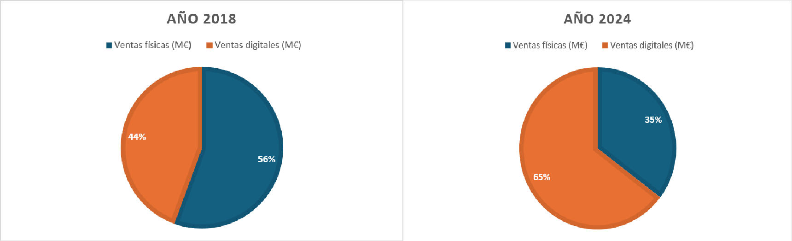

# Spanish Video Game Industry — Business & Market Analysis

**Market Research | Business Analysis | Excel | Strategic Analysis**

## Project overview

This portfolio project is based on my 2026 Bachelor's Degree dissertation, *Análisis actual y de la evolución del modelo de negocio de los videojuegos en España*. It examines the Spanish video game market, the structure of domestic game development studios, and strategic factors influencing competitiveness.

The original academic dissertation remains unchanged. The materials presented here are an adaptation for business analysis and data visualization, not a replacement for the dissertation.

## Research objectives

- Examine the evolution of the Spanish video game market and its business models.
- Compare physical and digital revenue channels.
- Analyze the distribution of Spanish game development studios by workforce size and annual revenue.
- Identify industry strengths, weaknesses, opportunities, threats and potential strategic responses.

## 1. Market revenue analysis (2018–2024)

The first analysis compares annual physical, digital and total market revenue in Spain, based on figures compiled from AEVI in the original research.

### Physical and digital sales comparison

**Key insight:** Digital sales increased their share of Spanish video game market revenue from approximately 44.4% in 2018 to 64.7% in 2024, highlighting the increasing role of digital distribution.

**Excel dataset:** [Spanish gaming market revenue (2018–2024)](data/spanish_gaming_market_revenue_2018_2024.xlsx)

## 2. Spanish game development industry structure

This analysis explores how Spanish game studios are distributed by workforce size and annual revenue, and how employment is distributed across studio sizes. The figures are based on DEV data reproduced in the dissertation.

**Key insight:** Small studios account for a substantial share of development companies, while a larger proportion of employment is concentrated in studios with more than 50 employees. The annual revenue distribution also shows a high proportion of studios in the lowest revenue brackets.

**Excel dataset:** [Spanish game studios structure](data/spanish_game_studios_structure.xlsx)

## 3. SWOT analysis and strategic recommendations

The original dissertation includes a SWOT analysis and an assessment using Porter's Five Forces. Its proposed measures for strengthening the Spanish development industry include:

1. **Strategic alliances:** Encourage collaboration between domestic studios.
2. **Foreign investment:** Explore international funding and acquisition opportunities.
3. **Market diversification:** Develop applications for areas such as education and healthcare.
4. **Outsourcing:** Provide development services to larger international companies.
5. **Original intellectual property:** Build recognizable game IP and franchises.
6. **Public funding:** Explore available public grants and financing programs.

These are strategic proposals derived from the research, not demonstrated outcomes.

## Methodology and sources

The original dissertation combined desk research, sector statistics, business frameworks and expert input. Principal reference organizations include:

- **AEVI** — Spanish video game market statistics.
- **DEV** — Spanish game development industry indicators.
- **DeVuego** — Spanish video game database and sector information.

The market revenue dataset covers **2018–2024**. The research and its underlying statistics have different reference years; see [SOURCES.md](SOURCES.md) for source details. Later report editions and any post-dissertation updates will be documented separately rather than silently replacing historical figures.

## Tools and deliverables

| Tool | Use | Status |
| --- | --- | --- |
| Microsoft Excel | Revenue and studio structure datasets; data visualization | Included |
| PowerPoint | SWOT and strategic recommendations | Documentation in progress |
| Power BI | Interactive dashboard | Deferred due to technical issues |

## Project status

**Portfolio adaptation in progress.** The academic dissertation is complete; additional visualizations, documentation and public release are being reviewed. This repository is currently intended to remain private until the materials are ready for publication.

## Author

**Sergio Gómez García**  
Graduate in Business Creation, Administration and Management (CADE)
